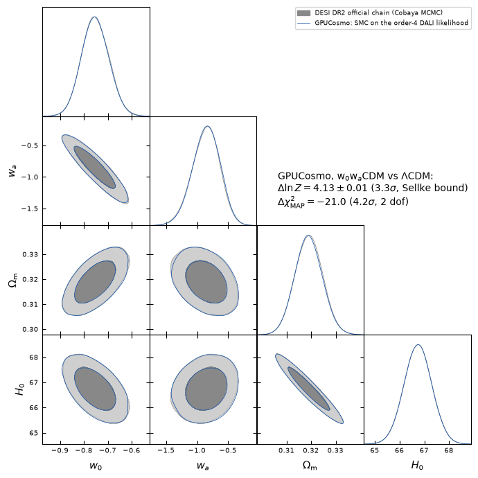

# GPUCosmo

> **Research preview.** GPUCosmo is usable for research within a bounded, tested scope
> ([docs/research_preview.rst](docs/research_preview.rst)). It is not a validated production
> code: the independent full-likelihood validation campaign is **pending**, so the evidences in
> particular are research results. Their quoted ± is Monte Carlo precision only (see
> [What the evidence uncertainties mean](docs/research_preview.rst#what-the-evidence-uncertainties-mean)).
> Release notes: [RELEASE_NOTES.md](RELEASE_NOTES.md).

GPU-native (JAX) cosmological likelihoods and Bayesian evidence:

- an Einstein–Boltzmann solver on the GPU (lensed CMB C_ℓ, CMB lensing, linear and HMcode
  P(k)) for w0waCDM, with CAMB's neutrino models and spatial curvature, jitted, vmapped over
  cosmologies and differentiable;
- likelihoods configured by Cobaya yamls: DESI DR2 BAO, Planck 2018 low-ℓ TT / EE and CamSpec
  NPIPE high-ℓ, ACT DR6 lensing, supernovae (DES-SN5YR, Pantheon+, Union3), BBN — native JAX
  ports where they exist, any other Cobaya likelihood through a bridge;
- **your own likelihoods** through a small plug-in API (`gpucosmo.likelihoods`);
- Bayesian evidence for model comparison: the likelihood in the DALI approximation (below) to
  any order, tempered SMC with HMC moves on it, and a convergence check of the DALI hierarchy.

**The DALI likelihood.** DALI (Derivative Approximation for LIkelihoods; Sellentin, Quartin &
Amendola 2014; Sellentin 2015) expands the model in the parameters inside the likelihood; the
expansion's order is the DALI order (1 Fisher, 2 doublet, 3 triplet, 4 quadruplet). GPUCosmo
expands the theory (CMB spectra, distances, P(k)) around the MAP to `--dali-order` (default 3)
and evaluates the analyses' own likelihood codes on that expansion. Unlike the Gaussian DALI of
the papers, the likelihoods keep their own form (Planck's low-ℓ Commander and SimAll, CamSpec,
ACT lensing, SN) and nuisance parameters stay exact. The evidence and posterior are those of
the DALI likelihood. After sampling, the expansion truncated to lower orders is evaluated at
the posterior draws, which shows how much the last orders changed log Z and the posterior (the
*order check*). The code calls it `dali` (`bundle.dali`, `CompressedDALI`, `--compressed-dali`,
`logz_dali`).

This preview contains what its three demos need (below). Documentation: `docs/` (Sphinx:
`sphinx-build -b html docs docs/_build/html`); start with
[docs/research_preview.rst](docs/research_preview.rst) (scope, limitations, error budget).

## Install

```bash
git clone https://github.com/Lhior/GPUCosmo && cd GPUCosmo
pip install ".[gpu]"             # core + JAX for CUDA 12 (CPU only: pip install .)
pip install ".[gpu,desi-full]"   # + Planck (clipy, candl), Cobaya, camb: demo 3
pip install -e ".[dev]"          # development: tests and docs
```

```bash
gpucosmo-paths          # data dir, Cobaya packages, caches; which data sets are present
gpucosmo-likelihoods    # built-in and registered likelihoods
```

## Demos

### 1. Your own likelihood, end to end on a CPU

[examples/custom_likelihood](examples/custom_likelihood): a background-only analysis (BBN and
n_s priors, BAO distances, and cosmic chronometers from a plug-in file) through the whole
evidence pipeline. No data files.

```bash
JAX_PLATFORMS=cpu gpucosmo-evidence --config examples/custom_likelihood/analysis.yaml \
    --plugin examples/custom_likelihood/my_likelihoods.py --outdir out_example
```

On a laptop CPU (2026-11-02, JAX 0.12): log Z_DALI = −14.720 ± 0.004 in 27 s with the default
triplet; order 2 → 3 changes log Z by −0.004.

### 2. CMB spectra on a consumer GPU, checked against CAMB

[examples/consumer_gpu](examples/consumer_gpu): lensed TT/TE/EE and κκ for a ΛCDM and a w0wa
cosmology, timed cold and warm and compared with a pinned CAMB reference. No data files.

```bash
python examples/consumer_gpu/run_example.py --out out_consumer_gpu
```

RTX 5070 Laptop (8 GB): 0.24–0.27 s per cosmology warm (batch of 8); lensed TT/EE at
ℓ 1000–2508 within 3.5e-4 of CAMB. The example's README has the recorded runs.

### 3. w0waCDM vs ΛCDM: DESI DR2 BAO + CMB + SN

The shipped analyses `w0wa_desidr2_cmb_{desy5,pantheonplus,union3}` and
`lcdm_desidr2_cmb_{desy5,pantheonplus,union3}`: DESI DR2 BAO, Planck 2018 low-ℓ TT and EE,
Planck CamSpec NPIPE TTTEEE, ACT DR6 lensing and one SN set. Install the likelihood data first
([docs/data.rst](docs/data.rst#data-for-the-desi-dr2-cmb-sn-demo)), then:

```bash
gpucosmo-evidence --analysis w0wa_desidr2_cmb_desy5 --dali-order 4 --auto-boxes 10 --ns-args "--smc-chunk 512" --outdir out_w0wa
gpucosmo-evidence --analysis lcdm_desidr2_cmb_desy5 --dali-order 4 --auto-boxes 10 --ns-args "--smc-chunk 512" --outdir out_lcdm
```

`--auto-boxes 10` samples ±10σ boxes around the MAP (log Z corrected by the volume ratio): these
yamls' priors are far wider than the posterior, and without boxes the DALI expansion is evaluated
where the Planck low-ℓ likelihoods are undefined. `--smc-chunk 512` keeps the SMC subprocess
within the GPU memory the exact stages leave free on an 8 GB card.

`--dali-order 4`: this analysis needs the quadruplet (below). Measured on an RTX 5070 Laptop
GPU (8 GB, WSL2), JAX 0.12, 2026-11-02/03, with the DES-SN5YR set:

| model | log Z_DALI (order 4) | order 3 → 4 | order 2 → 4 | build + SMC |
|---|---|---|---|---|
| w0waCDM (`w0wa_desidr2_cmb_desy5`, 17 parameters, 8 expanded) | −6375.636 ± 0.007 | +0.042 | +0.058 | 10 + 2 min |
| ΛCDM (`lcdm_desidr2_cmb_desy5`, 15 parameters, 6 expanded) | −6379.766 ± 0.006 | +0.019 | +0.034 | 4 + 2 min |

Δ log Z = 4.13 ± 0.01 in favour of w0waCDM for these yamls' priors (w ∈ [−3, 1],
wa ∈ [−3, 2]); a Bayes factor depends on those priors. The ± is Monte Carlo precision only
([error budget](docs/research_preview.rst#what-the-evidence-uncertainties-mean)), and these
evidences have not been validated independently.

After the DALI build no exact likelihood is evaluated: the SMC's HMC moves accept or reject on
the DALI posterior, and nothing is reweighted. The evidences and posteriors here are those of
the DALI likelihood. The supernova distances are DALI-expanded like the CMB spectra, and the
Gaussian likelihoods (CamSpec, ACT lensing, SN, BAO) are projected onto the expansion's
coefficients: CamSpec's χ² is a quadratic form over 1527 coefficients instead of its 9915 data
points, ACT's 19 bandpowers are linear in them. Only the non-Gaussian Planck low-ℓ likelihoods
read spectra, at ℓ < 30.

**The DALI hierarchy on this analysis.** The same analyses at orders 2, 3 and 4:

| DALI order | log Z, w0waCDM | log Z, ΛCDM | Δ log Z |
|---|---|---|---|
| 2 (doublet) | −6375.663 ± 0.009 | −6379.794 ± 0.009 | 4.13 |
| 3 (triplet) | −6375.683 ± 0.006 | −6379.787 ± 0.006 | 4.10 |
| 4 (quadruplet) | −6375.636 ± 0.007 | −6379.766 ± 0.006 | 4.13 |

(Orders 2 and 3: earlier runs with the supernova distances computed exactly and the CMB
likelihoods evaluated on the spectra; at order 4 the two forms differ by < 1e-4 in log L at the
posterior draws.) The order check of the order-4 runs shows why this analysis needs the
quadruplet: order 3 → 4 raises log Z by +0.042 (w0waCDM) and +0.019 (ΛCDM), more than 2 → 3 did
(+0.017, +0.013).
CamSpec's high-ℓ spectra depend on ω_c through a quartic term, even in the offset, which a
cubic cannot reproduce and the 2 → 3 step cannot see; the other expanded likelihoods (low-ℓ TT
and EE, BAO, ACT lensing) converge at the triplet. At order 4 the posterior means move by at most
0.02σ from order 3. The quadruplet costs 2049 exact theory evaluations for the build (10 min for
w0waCDM, against 4.5 min for the triplet); the SMC then takes about a minute (log L + gradient at
up to 500 000 points per second). The MAP and the sampling boxes (about 3.5 min) come first. How these orders compare with the exact likelihood is
in the [error budget](docs/research_preview.rst#what-the-evidence-uncertainties-mean).

**Against DESI's official chain.** GPUCosmo's SMC posterior (32 768 particles sampling the
order-4 DALI likelihood) over DESI DR2's public Cobaya chain for the same data (DESI + CMB +
DES-SN5YR, w0waCDM; 30 % burn-in):



| | GPUCosmo | DESI DR2 chain | shift / DESI σ |
|---|---|---|---|
| w0 | −0.753 ± 0.057 | −0.752 ± 0.057 | −0.02 |
| wa | −0.853 ± 0.221 | −0.861 ± 0.221 | +0.04 |
| Ωm | 0.3189 ± 0.0056 | 0.3191 ± 0.0056 | −0.03 |
| H0 [km/s/Mpc] | 66.74 ± 0.56 | 66.74 ± 0.56 | 0.00 |

The widths agree to 1 %. DESI DR2 Results II quotes w0 = −0.752 ± 0.057, wa = −0.86 (+0.23/−0.20),
Ωm = 0.3191 ± 0.0056, H0 = 66.74 ± 0.56 for this combination
([arXiv:2503.14738](https://arxiv.org/abs/2503.14738), Table 5).

**Preference for w0waCDM, in "n σ".**

| | GPUCosmo | published |
|---|---|---|
| Δχ²_MAP (−2 Δ ln posterior at the MAPs) | −21.04 → **4.20σ** | −21.0 → **4.2σ** (DESI DR2 Results II, Table 6) |
| Δχ²_MAP (−2 Δ ln L only) | −20.64 → 4.15σ | |
| Δ ln Z (Bayes factor B) | 4.13 ± 0.01 (B ≈ 62) → **3.3σ** | 4.88 ± 0.44 (PolyChord) → **3.6σ** (Lodha et al. 2025, [arXiv:2503.14743](https://arxiv.org/abs/2503.14743), Table 4) |

Conventions: Δχ²_MAP → n σ as in DESI DR2 (Wilks' theorem, a χ² with 2 degrees of freedom for
w0 and wa, quoted as a two-sided Gaussian n σ). Δ ln Z → n σ by the calibration
B ≤ −1/(e p ln p) of Sellke, Bayarri & Berger (2001, Am. Stat. 55, 62), as tabulated in Trotta 2008
([arXiv:0803.4089](https://arxiv.org/abs/0803.4089), Table 4.5: ln B = 4.0 ↔ 3.3σ, 5.0 ↔ 3.6σ):
the p-value whose largest possible Bayes factor equals the measured one, as a two-sided n σ.
It is an upper bound on the significance a Bayes factor can mean, and prior-dependent like B itself. On the Jeffreys scale
Lodha et al. use (ln B > 2.5 moderate, > 5 strong), both values are a moderate, nearly strong,
preference.

The 0.75 between the two Δ ln Z is within a single PolyChord run's scatter. GPUCosmo's value
was checked, on the order-2 DALI likelihood, by an independent estimator (importance sampling
from a Student-t fitted to the SMC particles: ln B 4.124 against the SMC's 4.130) and by the
Laplace approximation (4.32: Δ ln L at the MAPs +10.32, nuisance priors +0.20, prior volume of w0, wa
−2.74, posterior volume ratio −3.46; the rest is the curved w0–wa posterior). The prior
conventions do not close the gap: sampling H0 instead of θ_MC changes ln B by +0.0004, and
whether the w0 + wa < 0 cut is renormalised changes it by 0 or −0.25. PolyChord at Cobaya's
defaults (nlive = 25d, num_repeats = 2d, precision 0.001), run on Gaussian likelihoods with
these posteriors' covariances and priors, shows no significant bias but a single-run scatter of
about 0.6 in ln B, so 0.75 is about 1.2σ of one run. A nested-sampling run estimates the prior
volume it has compressed through statistically, with an error ≈ √(H / n_live) per evidence
(H ≈ 50 nats here); GPUCosmo's SMC starts from a fitted reference and computes the prior
volume exactly, hence ±0.01.

Reproduce the figure and numbers (DESI's chains: `base_w_wa/desi-bao-all_desy5sn_…` of the DESI
DR2 public release):

```bash
python scripts/compare_w0wa_vs_desi.py --w0wa out_w0wa --lcdm out_lcdm \
    --desi-chain PATH/desi-bao-all_desy5sn_planck2018-lowl-TT-clik_planck2018-lowl-EE-clik_planck-NPIPE-highl-CamSpec-TTTEEE_planck-act-dr6-lensing/chain \
    --out docs/figures/w0wa_desidr2_cmb_desy5_vs_desi
```

## Evidence pipeline

`gpucosmo-evidence` runs MAP → DALI expansion (`--dali-order`, default 3) → tempered SMC →
order check, resumably (stages whose outputs exist are skipped). The stages separately:

```bash
P="--config my_analysis.yaml --outdir OUT"
gpucosmo-dali-hmc $P --stage map
gpucosmo-dali-hmc $P --stage build --expansion-only --dali-order 3
gpucosmo-dali-ns  $P --stage ns --compressed-dali --tag smc
```

[docs/usage.rst](docs/usage.rst) and [docs/cli.rst](docs/cli.rst) describe the options.

## Adding your own likelihoods

```python
import numpy as np
from gpucosmo.likelihoods import GaussianLikelihood, register_likelihood

@register_likelihood
class CosmicChronometers(GaussianLikelihood):
    name = "cosmic_chronometers"

    def __init__(self, z, H, sigma, **options):   # yaml options; data as NumPy arrays
        self.z = np.asarray(z, dtype=float)
        super().__init__(data=H, cov=np.diag(np.asarray(sigma) ** 2), **options)

    def model(self, cosmo):            # cosmology only: the DALI approximation expands it
        return cosmo.H(self.z)
```

Name it in a yaml (`likelihood: {cosmic_chronometers: {z: [...], H: [...], sigma: [...]}}`)
and pass `--plugin my_likelihoods.py`, or declare it under the `gpucosmo.likelihoods` entry
point of an installed package ([examples/gpucosmo_example_plugin](examples/gpucosmo_example_plugin)).
Nuisance parameters, non-Gaussian likelihoods and access to the built-in CMB spectra:
[docs/adding_likelihoods.rst](docs/adding_likelihoods.rst).

## Tests

```bash
pip install -e ".[test]"
JAX_PLATFORMS=cpu python -m pytest -m "not slow"   # what CI runs on every pull request
python -m pytest -m slow                           # multi-minute convergence tests (GPU)
```

Tests that need likelihood data, a GPU or optional packages skip without them.

## Citing

If you use GPUCosmo, cite it as given in [CITATION.cff](CITATION.cff) (GitHub's "Cite this
repository" button), with the version or commit. GPUCosmo is built on other codes, and much of it
translates them to JAX. Please also cite the papers below for the parts you use (the authors of
those codes ask for them), and the data papers of every likelihood in your analysis
(`cobaya-bib <your.yaml>` lists them for Cobaya likelihoods).

- **DALI** (the approximation behind the evidence pipeline): Sellentin, Quartin & Amendola 2014,
  MNRAS 441, 1831 ([arXiv:1401.6892](https://arxiv.org/abs/1401.6892)); Sellentin 2015, MNRAS
  ([arXiv:1506.04866](https://arxiv.org/abs/1506.04866)).
- **Einstein–Boltzmann solver** (`jax/eb`, CMB spectra and lensing, linear P(k)), from CAMB:
  Lewis, Challinor & Lasenby 2000, ApJ 538, 473 ([astro-ph/9911177](https://arxiv.org/abs/astro-ph/9911177));
  Lewis 2026, JCAP 10, 013 ([arXiv:2607.14854](https://arxiv.org/abs/2607.14854)).
  Recombination (Recfast): Seager, Sasselov & Scott 1999, ApJ 523, L1
  ([astro-ph/9909275](https://arxiv.org/abs/astro-ph/9909275)); Wong, Moss & Scott 2008, MNRAS 386, 1023
  ([arXiv:0711.1357](https://arxiv.org/abs/0711.1357)).
- **Non-linear P(k).** HMcode: Mead et al. 2015 ([arXiv:1505.07833](https://arxiv.org/abs/1505.07833)),
  2016 ([arXiv:1602.02154](https://arxiv.org/abs/1602.02154)), 2021
  ([arXiv:2009.01858](https://arxiv.org/abs/2009.01858)). Halofit: Smith et al. 2003
  ([astro-ph/0207664](https://arxiv.org/abs/astro-ph/0207664)); Takahashi et al. 2012
  ([arXiv:1208.2701](https://arxiv.org/abs/1208.2701)).
- **μ–Σ modified gravity** in the solver, from ISiTGR: Dossett, Ishak & Moldenhauer 2011, PRD 84, 123001
  ([arXiv:1109.4583](https://arxiv.org/abs/1109.4583)); Garcia-Quintero, Ishak, Fox & Dossett 2019,
  PRD 100, 103530 ([arXiv:1908.00290](https://arxiv.org/abs/1908.00290)); with spatial curvature also
  Dossett & Ishak 2012, PRD 86, 103008 ([arXiv:1205.2422](https://arxiv.org/abs/1205.2422)).
- **CCL-syntax API, Limber C_ℓ, halo model** (`jax/ccl`): Chisari et al. 2019, ApJS 242, 2
  ([arXiv:1812.05995](https://arxiv.org/abs/1812.05995)); the Eisenstein & Hu 1998 transfer function
  ([astro-ph/9709112](https://arxiv.org/abs/astro-ph/9709112)); FFTLog, Hamilton 2000
  ([astro-ph/9905191](https://arxiv.org/abs/astro-ph/9905191)).
- **Intrinsic alignments (TATT) and FAST-PT** (`jax/fastpt_jax.py`): McEwen et al. 2016
  ([arXiv:1603.04826](https://arxiv.org/abs/1603.04826)); Fang et al. 2017
  ([arXiv:1609.05978](https://arxiv.org/abs/1609.05978)); Blazek et al. 2019
  ([arXiv:1708.09247](https://arxiv.org/abs/1708.09247)).
- **Cobaya** (likelihood ports, yaml input, the bridge): Torrado & Lewis 2021, JCAP 05, 057
  ([arXiv:2005.05290](https://arxiv.org/abs/2005.05290)).
- **ACT DR6 lensing** (`jax/cmb/act_dr6_lens_jax.py`): Madhavacheril et al. 2024
  ([arXiv:2304.05203](https://arxiv.org/abs/2304.05203)); Qu et al. 2024
  ([arXiv:2304.05202](https://arxiv.org/abs/2304.05202)); for the ACT + Planck variants also
  Carron, Mirmelstein & Lewis 2022 ([arXiv:2206.07773](https://arxiv.org/abs/2206.07773)).
- **candl likelihoods**: Balkenhol et al. 2024, A&A 686, A10
  ([arXiv:2401.13433](https://arxiv.org/abs/2401.13433)).
- **Planck PR4 HiLLiPoP / LoLLiPoP**: Tristram et al. 2024, A&A 682, A37
  ([arXiv:2309.10034](https://arxiv.org/abs/2309.10034)).
- **The demo's data** (cite those you use): DESI DR2 BAO, DESI Collaboration 2025, PRD 112,
  083515 ([arXiv:2503.14738](https://arxiv.org/abs/2503.14738)); Planck 2018 likelihoods (low-ℓ TT
  and EE), Planck Collaboration 2020, A&A 641, A5 ([arXiv:1907.12875](https://arxiv.org/abs/1907.12875));
  CamSpec NPIPE, Rosenberg, Gratton & Efstathiou 2022, MNRAS 517, 4620
  ([arXiv:2205.10869](https://arxiv.org/abs/2205.10869)); DES-SN5YR, DES Collaboration 2024, ApJL 973,
  L14 ([arXiv:2401.02929](https://arxiv.org/abs/2401.02929)); Pantheon+, Brout et al. 2022, ApJ 938,
  110 ([arXiv:2202.04077](https://arxiv.org/abs/2202.04077)); Union3, Rubin et al. 2023
  ([arXiv:2311.12098](https://arxiv.org/abs/2311.12098)).

## License

GPUCosmo is free software under the GNU General Public License, version 3 or (at your option)
any later version ([COPYING](COPYING)). Code translated from other projects keeps their copyright
notices; see [NOTICE.md](NOTICE.md) and [LICENSES/](LICENSES). The parts derived from CAMB carry
CAMB's additional conditions, listed in [NOTICE.md](NOTICE.md#cambs-additional-conditions):
among them, any publication using results of the code must be submitted to arXiv no later than
to a journal.
